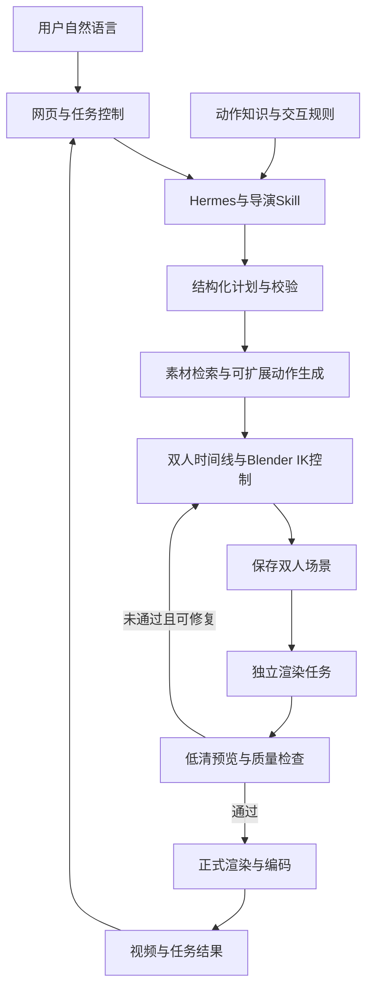
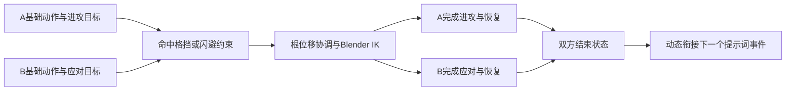

# 白膜参考视频系统双人打斗开发计划书

编制日期：2026 年 10 月 12 日

方案版本：第二版 自然语言动态编排与 Blender IK

本计划将现有单角色白膜视频系统扩展为自然语言驱动的双人打斗系统。最终目标是根据提示词动态组织多种拳法、踢击、格挡、闪避、移动、反击及逐步扩展的交互动作。Hermes 负责理解人物关系、动作要求和攻防节奏，形成双方时间线及交互目标；基础动作来源与程序化控制提供运动，Blender IK 和空间控制负责落实接触、支撑和姿势修正，检查器确认构图与输出质量。

技术路线采用“自然语言动态编排、可扩展动作来源、统一交互约束、Blender IK 与质量检查”。经过验证的成对片段保留为基准样例和可选缓存，不作为全部可生成内容的固定清单。开发初期的一记直拳或少量组合用于检验基础技术，不能代替最终目标的动作覆盖与动态组合验收。

首个验证场景为两名标准角色、徒手、平地；后续形成 15 秒、30 FPS、1280×720 的连续打斗参考视频，并按提示词改变双方角色、动作顺序、攻防结果、节奏和空间关系。两个人全程全身入镜。本文中的工具接口、目录、指标和阶段任务均为开发目标；当前运行版本仍是单角色版本。

## 1 开发目标与范围

用户可以输入：“两个人面对面打斗，A 连续出拳，B 防守后反击，最后双方拉开距离。动作紧凑自然，15 秒，始终完整显示两个人。”系统在内部形成可执行计划，用户无需选择 FBX 文件、填写 JSON 或指定骨骼和相机参数。

用户可以改变动作顺序、进攻者、攻击部位、防守方式、命中或落空的结果、距离与节奏，系统据此生成不同的编排及控制轨迹。用户无需选择现成套路；运行时也不能把所有需求都转换成同一段视频，只修改文件名或循环次数。

动作覆盖由基础动作、程序化运动和可接入的文本到动作生成器共同扩展。现有 63 个 FBX 是起始资源，不是最终能力的上限。超出当前动作来源的关键要求应明确说明；系统不能仅靠 IK 宣称能够凭空生成任何招式，也不能把技术选材问题交给用户选文件。

| 范围 | 目标与首个验证范围 |
| --- | --- |
| 人物与场景 | 两名标准 Beta 角色，同一骨骼标准，平坦地面，以浅灰材质呈现；可用轻微灰度差区分角色 |
| 动作内容 | 最终支持多类别动作与动态攻防组合；初期以拳法与反应验证基础，再扩展踢击、格挡、闪避及移动 |
| 输入方式 | 自然语言；角色身份、强弱、节奏和镜头意图在内部转换 |
| 镜头与视频 | 默认固定斜侧全景，15 秒、30 FPS、1280×720，两人全身入镜 |
| 生成方式 | 动态计划、动作来源和 IK 约束共同执行；新组合经过运行时检查，不要求每种组合都有手工预制片段 |
| 动作扩展 | 在本路线内逐步评估武器、摔投、地面缠斗等新类别，需要相应基础运动、控制规则和验证 |
| 其他扩展 | 多人、复杂场景、完整环绕、任意体型及完整物理模拟在双人核心能力稳定后继续建设 |

对超出已支持范围的需求，系统应说明哪一部分暂时无法实现。可以自动调整节奏、镜头和同义选材；涉及用户明确要求的关键招式时，不能静默替换并宣称完整满足。

## 2 现有实现与必要修正

现有主链路为自然语言输入、Flask 组织提示、Hermes 经 MCP 调用 Blender helper、独立 headless Blender 渲染 PNG、ffmpeg 编码 MP4。网页已经具备日志流和历史视频展示，可以继续作为双人版本入口。

当前代码中，`wm_import` 保留第一个角色，后续 FBX 仅提取动作并删除重复角色；`_armature` 返回第一个骨架；`_STATE` 只记录一组动作与镜头参数。`wm_render` 调用 `render_white_model.py` 重建单人场景。现有跨轨道混合避免了淡回默认姿势的问题，但动画仍按等长片段循环填充。

| 需要修正的部分 | 开发决定 |
| --- | --- |
| 多动作仍对应一个角色 | 增加角色 ID 和独立角色集合，每人独立管理骨架、动作、空间变换和状态 |
| 等分时长与自动循环 | 使用明确的动作段和交互事件；攻击与受击默认播放一次，只允许经验证的等待动作循环 |
| 固定组合无法覆盖提示词 | 由提示词生成事件、双方基础动作及控制目标，按通用规则和运行时检查组合；已配对片段作为参考与缓存 |
| 只有姿态混合而无接触控制 | 为双方建立可复用的 IK 控制层，统一求解攻击目标、格挡接触、落脚与衔接姿态 |
| 只关注姿势相似 | 切换同时检查姿势、速度、支撑脚、朝向和双方相对位置；关键动作阶段不得被裁掉 |
| 原地素材也可能有中间位移 | 记录全段腰胯与足部轨迹，区分整体行进和局部身体运动，防止位移重复叠加 |
| 单帧包围盒与强制环绕 | 以动画变形后的两个人物计算全片运动范围，独立设置时长和镜头策略 |
| 预览与最终场景可能不同 | 双人场景编排、修正和检查完成后保存 `.blend`，预览及正式渲染均加载该场景 |
| 共享场景和输出目录 | 第一版生成任务串行执行，增加任务 ID、场景归属和独立中间产物目录 |
| 长工具调用与结果误判 | 渲染采用提交任务和查询状态；输出同时通过退出状态、文件及媒体信息核验 |

`render_saved_scene.py` 已具备渲染保存场景的基本结构，但当前 `wm_render` 没有调用它。它还需要补齐场景帧率、失败退出码、帧数核验及任务状态，才能作为双人生产路径。

## 3 素材兼容与可用性

六个代表性素材已在独立 Blender 5.2.2 LTS 进程中读取。它们均有 65 根骨骼，骨骼名称与父子关系一致，初始骨架矩阵一致，每个动作有一个 Action Slot，导入场景帧率为 30，骨架缩放为 0.01。该结果支持标准角色之间的动作复用；角色间的动作绑定仍需显式处理 Action Slot，修改动作前需要复制数据。

| 素材 | 源动作帧范围 | 在首版中的用途 |
| --- | --- | --- |
| `Mma Idle` | 1 至 151 | 格斗待机候选，需验证与动态动作的接口姿势 |
| `Lead Jab` | 1 至 56 | 直拳进攻候选 |
| `Hook` | 1 至 73 | 勾拳进攻候选 |
| `Mma Kick` | 1 至 49 | 踢击基础运动候选，验证支撑脚及进攻足 IK |
| `Hit To Body` | 1 至 36 | 躯干受击候选 |
| `Head Hit` | 1 至 47 | 头部受击候选 |

素材核对记录保存于 `计划配图/双人打斗素材核对.json`。该记录验证了骨骼结构和运动元数据，没有验证攻防配对、接触、动作语义或视觉质量，也不代表全部 63 个素材均已完成双人验证。

`Lead Jab` 的 Hips 世界位置在某一水平轴上的全段变化幅度约为 0.74 米，`Hook` 约为 0.67 米。Hips 运动包含腰胯运动及可能的局部迈步，不能直接解释成整个角色的纯平移。动作最后回到起点，也不能证明中间始终原地不动。

基础动作需要标注准备、出招、接触、回收、恢复和支撑脚阶段。先用代表性攻防样例校准目标定位、时序、IK 范围及姿势修正，再将得到的规则用于同类动作的动态组合。个别受击动作无法与格斗姿势衔接时，需要修整基础运动、局部姿势控制或补充素材，不能靠增加过渡时长掩盖。

## 4 系统架构与职责

双人版本保留网页、Hermes、MCP 和 Blender 的主链路，增加结构化计划、可扩展动作来源、IK 控制层和任务管理。语言模型负责意图解释、双方事件编排和控制要求；基础运动生成、骨骼计算、时序与空间协调及验证由可执行工具完成。

| 组成部分 | 主要职责 | 输出 |
| --- | --- | --- |
| 网页与 Flask | 接收自然语言、分配任务 ID、排队、推送状态和返回任务对应结果 | 请求、任务状态、视频地址 |
| Hermes 与导演 Skill | 理解人物关系、动作意图与节奏，生成双方事件及目标约束 | 动态内部计划 |
| 动作知识与交互规则 | 保存基础动作事实、控制范围、攻防关系和可复用策略；成对片段用作参考 | 专业数据与生成约束 |
| 动作来源接口 | 根据意图检索素材、生成程序化轨迹，或调用独立动作模型，再转换到标准骨架 | 双方基础运动 |
| 计划校验器 | 校验结构、资源或生成器 ID、关键阶段、角色引用、时长与可达范围 | 合法计划或明确错误 |
| Blender 编排与 IK 工具 | 管理角色与时间线，建立目标轨迹，协调根位移、手脚 IK、衔接及相机 | 求值后可保存的双人场景 |
| 渲染任务与检查器 | 预览、几何检查、正式渲染、编码和媒体核验 | MP4、检查报告及失败原因 |

第一版同一时间只允许一个任务修改常驻 Blender 场景。即使渲染已经放到独立进程，也需要保护场景搭建与保存阶段，避免另一个请求清空或覆盖场景。多任务并行需要独立 Blender 工作进程池，放在后续扩展范围。

## 5 知识系统与内部数据

导演 Skill 负责攻防原则、动态编排、工具流程和能力边界；动作元数据负责素材事实；交互规则负责“攻击、命中、格挡、闪避、反击”等事件怎样形成双人目标约束。逐帧轨迹与骨骼数据由工具读取和计算，不要求模型直接输出数万条骨骼旋转值。

建议增加 `knowledge/motions/`、`knowledge/interaction_rules/`、`knowledge/motion_providers/` 和 `knowledge/duel_examples/`。分别保存基础动作、交互及 IK 控制规则、动作来源接口配置、经过验证的样例和缓存。保持现有导演 Skill 为入口，按需引用数据；基础闭环无需增加向量数据库或训练新模型，动作模型接入另按动作来源扩展阶段评估。

| 数据对象 | 必需信息 |
| --- | --- |
| 单动作 | 资源 ID、文件哈希、骨骼标准、源帧率、阶段标记、关键点、支撑脚、全段轨迹与循环条件 |
| 交互规则 | 事件类型、目标部位、结果、准备与接触窗口、方向与距离条件、IK 可达范围、支撑条件和反应策略 |
| 动态衔接 | 前后动作状态、合法裁剪窗口、速度范围、支撑脚及双方相对位置，评分和拒绝条件 |
| 动作来源 | 素材、程序化轨迹或模型的输入输出约定、支持类别、骨架与坐标标准、版本和失败原因 |
| 已验证样例 | 双人运动、实际参数、检查结果及适用范围，供回归、参考或缓存复用 |
| 内部计划 | 版本、任务 ID、时长、帧率、角色列表、动态事件、动作来源、接触或避让目标、IK 权重、镜头约束和随机种子 |
| 执行与检查记录 | 资源哈希、工具版本、实际参数、场景文件、失败帧、质量指标、预览与视频路径 |

基础动作、生成器和控制规则需要先验证。组合可以在运行时新建，不要求提前枚举所有攻防顺序；新结果经过接触、支撑、连续性及预览检查后返回。运行时生成合格视频，不等于该组合在所有参数下都已验证；缓存和专业经验的发布仍保留版本与适用条件。

基础动作来源分三类。第一类检索和重定时现有动作，适合保留自然的身体运动。第二类使用经验证的程序化轨迹和姿势控制生成移动、格挡目标、不同攻击落点及短过渡，其可用范围由身体可达性和视觉验收确定。第三类接入文本到动作或双人交互生成模型，为原素材库没有的运动提供新来源，生成后重定向到标准角色，再交给 IK 与质量检查。

如果最终要求包括素材库中不存在的新招式，动作来源扩展是必要工作。Hermes 的文字规划和 Blender IK 都不能替代完整基础运动的生成。文本到双人动作研究已经提供可参考路线，例如 InterGen；它仍需实际评估文字控制、打斗细节、输出骨架、硬件、依赖及许可，不能仅因论文支持双人生成就认定能直接替换当前渲染链路。[InterGen 官方实现](https://github.com/tr3e/InterGen)

角色列表使用 `actors`，交互事件记录进攻者、目标及参与者。首版校验器限制角色数为二；数据结构为后续多人扩展保留参与者字段，但不据此宣称已支持多人。

## 6 动态交互编排与 Blender IK

每次交锋由提示词生成的事件定义，包含进攻者、目标、动作意图、结果、空间关系及阶段时序，再为双方分别产生基础运动和控制目标。事件覆盖等待、准备、进攻、反应和恢复。双方所有帧都有有效姿态，未进攻的一方保持符合语义的防守、观察或移动。

### 6.1 可复用的 IK 控制层

IK 是双人执行层的核心组成。为每个标准角色建立双手、双脚的控制目标与肘膝方向控制，以及独立的整体位置、骨盆和躯干控制。基础动作提供初始运动，IK 在事件约束下调整手脚位置；程序外层协调根位移、身体姿态、支撑和双方关系。

手部 IK 用于指定部位的拳击接触、双方格挡目标和手臂姿势过渡；足部 IK 用于踢击目标及落脚稳定。支撑脚按标注阶段锁定，迈步或抬腿时解除相应约束。控制权重随阶段平滑变化，并设置骨链长度、关节范围和肘膝方向，避免突然翻转和不合理伸长。

Blender IK 根据目标求解骨链姿态，不负责理解提示词，也不会自行产生完整的出招、回收、重心与反应。因此它需要动态计划、基础运动及目标轨迹共同驱动；多帧连续性和双人空间协调需要额外的程序控制。[Blender IK 说明](https://docs.blender.org/manual/en/latest/animation/constraints/tracking/ik_solver.html)

双方接触由独立的公共目标或有向控制关系承载。禁止同时让 A 的手追随 B 的手、B 的手又追随 A 的手而形成求值循环。先确定公共接触点与双方身体位置，再分别求解骨链并检查结果；修正幅度超出允许范围时调整站位、基础动作或事件方案。

### 6.2 时间同步与攻防结果

以统一事件时间轴同步双方准备、进攻、接触或最近接近、反应和恢复，双方基础动作可来自不同来源，其时间映射须对齐这些阶段。复用已有成对缓存时可以共享时间映射，但不能将共享映射作为所有独立素材必须同长的限制。

命中事件对齐攻击末端到达目标的时刻与受击显著反应。格挡允许提前抬臂，并把接触目标改为格挡部位。闪避允许提前移动或改变躯干姿态，使目标离开攻击轨迹；此时必须锁定出招落点或限制攻击追踪，不能一直让拳脚 IK 追着移动中的对方，否则闪避会变成必中攻击。命中、格挡和落空分别检查接触或避让条件。

源动作先按真实帧率换算为秒，再映射到场景帧。裁剪范围须完整保留关键出招、接触和必要恢复。15 秒、30 FPS 的最终输出固定为 450 帧，使用统一的帧区间约定，明确处理动作端点和输出最后一帧。

首版基础素材播放速度限制可先设为原速的 0.85 至 1.15 倍，作为待验收校准的工程范围；双方通过事件关键时刻约束各自重定时。程序化或模型生成运动遵守相同的速度及关节范围检查。时长不足时调整事件数量和等待段，不能让攻击自动循环；无法在给定时长完整覆盖要求时，明确提示限制。

### 6.3 空间对齐与根位移

每个角色设置独立的空间控制节点，承担整体位置与朝向；骨架动作保留局部身体运动。对于仅有 Hips 根骨的素材，需要通过足部与身体轨迹分析及制作标注提取整体行进，不能直接清空全部 Hips 水平运动。

动态事件依据当前双方状态生成位置、朝向和目标轨迹，再用接触、可达性、支撑和碰撞近似约束调整。复用已配对缓存时优先整体变换，保留其相对关系；新组合则由控制程序计算双方空间关系。相对距离变化通过合理的移动、转身或身体调整实现，不能分别瞬移两人来强行满足接触。

攻击目标记录在受击者局部坐标中，并明确指向身体表面或格挡目标。接触位置以动画求值后的世界坐标检查。空间调整同时考虑接触距离、角色间距、足部约束和躯干穿插，避免只把手摆到目标位置却破坏下半身。

### 6.4 动态衔接与姿势修正

依据前后动作状态动态选择切换窗口，评分比较关键关节相对姿势、关节速度、支撑脚、朝向及双方相对位置。兼容性由通用条件、状态及求值结果判定，可缓存成功衔接，不要求每一种组合都提前编写一条固定边。姿势匹配只在允许的准备或恢复窗口内进行，不能为了低误差而从出招中途跳走。

小幅姿势差采用短混合，并以 IK 保持支撑脚和必要接触。明显差异通过收招、转向、防守等基础运动或受控程序化过渡修正，再检查姿势和速度连续性。混合时保持基础动作覆盖，避免空轨道或双重淡出引入默认姿势。所有过渡不得延长最终视频时长或破坏已经对齐的事件。

IK 与程序化目标变化有明确范围，基础动作仍负责主要动势。需要过大修正时重新选择或生成运动，不能将直拳任意扭成侧踢，也不能凭目标可达就认为重心和力量感自然。

求解后的目标、约束和姿态随场景保存，必要时烘焙为动画，确保独立渲染重现结果。角色交换由事件中的进攻者与目标映射驱动；空间镜像、左右拳互换和骨骼镜像需要对应规则和检查，不能只设置负缩放后直接使用。

## 7 全身镜头与遮挡检查

视频时长使用独立的 `duration_seconds`；固定镜头、跟随和环绕使用单独的镜头策略。首版默认固定斜侧全景，镜头不改变视频帧数，也不自动把角色动画循环填满。

相机覆盖整个片段序列的双人运动范围。每帧求值骨架及变形后的角色网格，以角色集合为统计范围，排除地面、灯光、辅助控制器等对象。先拟合全片运动包络，再逐帧检查最终相机投影；不能只用角色身高或初始帧包围盒推断全身始终可见。

首版屏幕安全边距目标为画面宽高的 5%。对每一帧检查两名角色变形后的边界、近远裁剪和相机前后关系。Blender 的 `world_to_camera_view` 能将世界坐标映射到画面坐标，供出画检查使用。[Blender 相机投影接口](https://docs.blender.org/api/current/bpy_extras.object_utils.html)

人物完整入镜与人物动作可读分别验收。两人的包围盒都在画面内，并不能证明前后站位没有遮挡。系统从允许的斜侧角度中选择遮挡较少的机位，预览时检查头部、躯干和关键攻防动作；非接触段不能有一人被另一人完全遮住。完整环绕在遮挡与跟随策略验证后再开放。

## 8 渲染任务与结果可靠性

首版采用一个生成队列，任务从解析、计划校验、场景搭建、预览检查、正式渲染到媒体核验顺序推进。可重试步骤在同一任务内执行，状态明确区分运行、成功和失败。

生成任务从开始到场景保存全程持有场景使用权。保存后的场景包含两个角色、动作槽、轨道、空间控制、修正结果、相机、材质和灯光。相关约束目标和必要资源一起保存；无法随场景恢复的临时 Python 驱动应改为可保存数据或烘焙结果。

MCP 工具调用完成短操作后返回任务 ID；正式渲染由独立进程执行，Agent 和后端通过状态接口查询。当前安装的 `mcp-for-blender` 2.1.9 socket 接收超时为 180 秒，而 helper 的子进程等待上限为 300 秒；双人渲染耗时可能增加，因此不能只提高其中一层超时解决长任务问题。

草稿预览可以使用 640×360，与最终 1280×720 保持相同宽高比、帧率、时间线和相机。预览与正式渲染加载同一个通过检查的场景；正式渲染只改变分辨率和画质参数。

中间产物建议保存到 `output/jobs/<job_id>/`，包括 `plan.json`、`scene.blend`、`preview.mp4`、`quality.json`、`result.json` 和日志。最终视频使用唯一文件名放在现有 `output/` 视频库下，使历史视频仍能展示。后端通过任务结果定位视频，停止依赖全目录新增文件差集或 Agent 文本中的文件名。

成功必须同时满足渲染和编码退出状态正确、视频文件存在、媒体可解码、帧率与帧数正确以及检查报告通过。ffmpeg 失败应返回非零退出码，不能只打印错误然后继续返回成功。`render_saved_scene.py` 必须同步设置 `scene.render.fps` 与编码帧率，防止动画速度和视频时长不一致。

失败时保留计划、场景、预览和检查数据。同一幂等请求不得重复启动渲染进程。自动修复最多两轮；每轮仅修正明确失败项，仍未通过则报告限制，禁止无限重试或静默遗漏用户要求。watchdog 应依据受管进程身份重启服务，避免通过笼统的 Blender 名称匹配误杀独立渲染任务。

渲染前检查可用磁盘空间。编码及媒体核验通过后，可清理能够重建的 PNG 序列，保留视频、场景、计划和质量报告；失败任务保留诊断所需关键帧和日志，防止连续生成使磁盘空间持续耗尽。

## 9 模块改造与交付物

| 模块 | 具体工作 | 验收证据 |
| --- | --- | --- |
| `web/app.py` 与网页 | 增加任务 ID、单任务排队、状态回传和结果归属；自然语言入口继续使用 | 两个连续或同时提交的请求不覆盖场景、不串视频 |
| `scripts/preload_helpers.py` | 增加角色集合和双人计划工具；清场、导入、镜头和输出按任务管理 | 两个骨架独立播放，角色身份可追踪 |
| `scripts/animation_sequence.py` 与新动态编排模块 | 保留单人接口；双人采用事件关键时刻、独立动作重定时、状态匹配及 IK 过渡 | 单人回归通过，动态时间线无空段、无额外攻击循环 |
| 新动作分析与来源模块 | 记录骨骼、阶段、支撑脚、轨迹和哈希；统一素材、程序化与模型来源接口 | 可检索动作、生成轨迹、骨架转换和动作覆盖说明 |
| 新双人 IK 与检查模块 | 建立控制目标和骨链，协调接触、格挡、避让、根位移、支撑、衔接及镜头 | 求解轨迹、失败帧、接触或避让误差、滑步及构图报告 |
| `scripts/render_saved_scene.py` 与渲染任务模块 | 保存并加载双人场景，异步渲染、编码和媒体核验 | 保存后重新加载仍保留双人动作和镜头，输出可播放 |
| `white-model-director/SKILL.md` 与后端提示 | 描述动态事件、动作来源、IK 目标、时长、镜头、支持范围及失败处理 | 提示词生成不同计划，用户无需选择文件或套路 |
| `tests/`、启动及守护脚本 | 增加真实双人场景回归与失败用例，隔离服务和渲染进程 | 测试记录、故障定位和可用回退路径 |

双人专用工具建议分为动作检索或生成、角色与 IK 控制建立、动态计划执行、质量检查、渲染提交和状态查询。可采用 `wm_duel_build`、`wm_duel_solve`、`wm_duel_validate`、`wm_duel_submit_render` 和 `wm_duel_status` 等接口；具体命名在实现时确定，拟新增能力不能写成当前已具备能力。

## 10 开发阶段与放行条件

阶段按依赖与验收推进，先验证标准骨架与 IK，再建立动态双人执行、自然语言编排和动作来源扩展。工程工期在骨架、控制层及代表性运动通过后细化；控制范围、基础动作覆盖和生成器适配是主要工期变量。初期少量样例是测试夹具，最终验收必须包括未预制的新动作顺序和多类别动作。

| 阶段 | 工作与交付 | 进入下一阶段的条件 |
| --- | --- | --- |
| M0 标准骨架与 IK 验证 | 建立开发分支；整理动作阶段；为双方建立手脚、肘膝和整体空间控制，测试直拳接触及落脚 | 手部目标、足部支撑和骨链控制有效，无循环依赖、关节翻转或不合理伸长；样例只用于验证基础 |
| M1 双人执行闭环 | 固定内部测试计划完成任务 ID、场景互斥、两角色、统一时间线、IK 求值及约 4 至 6 秒视频 | 保存并重新加载后结果一致；接触、支撑、姿态覆盖、编码和任务归属通过 |
| M2 动态连续攻防 | 实现基础动作检索、动态事件与目标轨迹、独立重定时、根位移协调及状态衔接，生成 15 秒序列 | 改变顺序、角色、接触部位和命中或落空结果时产生相应变化；至少完成一个非预制组合 |
| M3 自然语言导演 | Hermes 从提示词生成双方事件和控制要求，接入检查与有限修复；逐步覆盖拳、踢、防、闪、移 | 多类别提示词及未预制顺序通过；不要求用户选文件，无法覆盖的类别如实说明 |
| M4 动作来源扩展 | 建立可扩展来源接口，针对缺少的运动补素材或程序化控制；评估文本到动作及双人生成模型，完成适配与检查 | 至少接入一种原 63 个素材未覆盖的基础运动来源；输出统一骨架、坐标和时序，并通过相同 IK 与质量验收 |
| M5 泛化回归与发布 | 执行未预制提示词组合、多类别动作和失败恢复用例，验证单人回归；记录性能与版本 | 达到动态编排和动作覆盖验收目标，发布阶段标签，保留单人基线可回退 |

新动作类别通过基础运动、控制规则和结果质量验证后加入能力目录，而不是要求预先手工制作该类别的所有成对组合。武器、摔投等复杂动作还需要专门的持物、接触保持、重心及反应约束，不能直接沿用拳法参数。M0 与 M1 完成不等于最终目标完成。

## 11 验收指标与验证方法

以下数值是首版工程目标，尚不是现有系统的实测成绩。以标准角色身高 H 归一化空间阈值，在 M0 标准场景中校准并记录。每项自动指标都需要相应的视觉验收，不能将几何合格等同于动画自然。

| 验收项 | 首版目标与方法 |
| --- | --- |
| 人物与动画隔离 | 两名独立角色，角色集合归属明确；分别改变一方片段时不覆盖另一方动画状态 |
| 视频规格 | 15 秒、30 FPS、1280×720、450 帧；用 ffprobe 核验实际解码帧数及帧率，容器时长允许最多一帧舍入误差 |
| 命中同步 | 指定命中事件的显著受击反应与接触时刻误差不超过 2 帧；格挡和闪避按各自窗口验收 |
| 接触距离 | 指定接触帧的进攻末端与身体表面目标误差不超过 0.03H；人工检查不存在打空气或大幅穿入身体 |
| 格挡与闪避 | 格挡目标对应双方手臂接触；闪避事件要求预定攻击轨迹落空，不产生自动追踪必中；按全段运动检查 |
| 支撑脚稳定 | 标记的落脚阶段，相对该次落脚固定点的最大水平偏移目标不超过 0.01H；起落脚和有意迈步单独标注，不将其判作滑步 |
| IK 控制可复用 | 使用同一控制层改变目标落点、双方距离与基础动作，控制目标求解有效；修正越界时明确拒绝或重新规划 |
| 连续动作 | 双方全片有有效动作覆盖，无意外默认姿势、攻击重复循环、角色瞬移或裁掉关键出招 |
| 全身构图 | 所有输出帧中，两名角色变形后的边界处于画面 5% 安全边距以内，且未被相机裁剪 |
| 交互可读性 | 非接触段无人被完全遮挡；关键出招、接触、反应与攻防交换能在预览中分辨 |
| 穿插与姿势 | 对躯干和重要肢体做几何近似筛查，再检查预览；接触允许局部重叠，但不得有明显躯干穿透、关节翻转或不合理伸长 |
| 自然语言覆盖与新组合 | 最终至少 20 条用例，每条验证 3 次，覆盖拳、踢、格挡、闪避、移动与反击；至少 10 条动作顺序或角色关系未作为整段模板预制，关键要求均覆盖 |
| 提示词控制有效 | 单独改变角色、招式顺序、进攻部位、应对结果或节奏时，计划和运动产生对应变化；不得所有输入返回同一套路 |
| 新动作来源 | 至少一种原素材库没有的基础运动通过标准骨架转换、IK、支撑、时序和视觉检查；不将仅有接口误写成已具备新动作能力 |
| 任务可靠性 | 同时提交两项任务时正确排队；错误路径、无效角色引用、渲染失败和编码失败均返回失败，无视频串单 |
| 单人回归 | 现有动画轨道测试及代表性单人、单动作、多动作、全身镜头用例通过 |

同一提示词的重复生成允许节奏或细节变化，支持范围、关键意图、输出规格和硬约束必须一致。未预制组合在实现通用控制后选取，不能为每条验收提示词专门编写整段动画。阶段尚未覆盖的类别保留为待达成目标，不能用“提示限制”替代最终正常生成验收。

最终能力是提示词驱动的多类别动态打斗，不承诺所有想象中的动作在任何条件下都自然。当前支持范围和新增来源需要持续记录；动作覆盖与生成质量分别验收，避免只增加文件数量而没有实际可用运动。

预览检查至少覆盖全片、每个接触窗口和每个衔接窗口，并保留这些关键帧。自动检查器负责捕获明显错误；动势、力量感、反应强度和动作协调由视觉验收确认。验证数据固定资源版本，区分“固定计划执行正确”和“Hermes 能正确生成计划”两个问题。

## 12 自然语言与动态组合用例

以下文本用于覆盖不同攻防关系和运动类别，不要求用户指定素材。它们是验收输入，不是要硬编码的整段套路；在其基础上增加未预制顺序和角色交换用例，达到至少 20 条的最终验收集。

1. 两个人面对面，A 出一记直拳，B 躯干受击后恢复，双方保持防守姿态，完整显示两人。
2. A 连续出拳，B 侧移躲开，再由 B 踢腿反击，A 抬臂格挡，15 秒。
3. B 先出勾拳，A 后撤闪避，然后向 B 躯干反击，人物全身入镜。
4. A 先试探，B 等待并观察，随后双方交换攻防，动作有轻重变化。
5. 两个人进行较慢的拳法与踢击对练，接触和反应清楚，镜头保持斜侧全景。
6. A 向上出拳，B 低头躲开，随后 B 向 A 腹部反击，动作之间协调。
7. A 连续进攻，B 以格挡和移动防守，反击后双方拉开距离，最后保持戒备。
8. 两个人先进行拳法交锋，再交换踢击和防守，保持合理站位与脚步，15 秒。
9. 使用同样的动作意图，但将 A 与 B 的进攻顺序交换，结果应体现新的角色关系。
10. 将前一条的节奏改慢，保留动作意图和攻防结果，增加合理观察与恢复。
11. 同样的一次直拳，先要求命中，再要求被格挡，再要求被闪避；三种控制目标与运动结果应不同。
12. 指定一个当前来源尚未覆盖的新动作，系统先准确报告限制；接入该运动来源后，同一提示词转为正常生成验收。

踢击、格挡、闪避与移动是动作覆盖目标，按相应阶段完成基础运动、控制与视觉验收后正常生成。样例十二的限制提示属于可靠性检查，不能替代前十一类用例的成功生成，也不表示新动作永远留在范围外。

15 秒演示的事件顺序由提示词生成，可包含进攻、躲避、格挡、命中、反击和收势。具体时长按动作关键阶段、反应和恢复需求确定，不采用固定平均分段或唯一的演示剧情。

## 13 主要风险与处理

| 风险 | 对结果的影响 | 处理与停止条件 |
| --- | --- | --- |
| 基础运动与交互目标不兼容 | 方向不符、打空气、反应强度不符 | 动作检索、阶段标注、空间控制和 IK 联合处理；越界时重新规划、修整或获取新运动 |
| 固定样例被当成最终能力 | 多种提示词返回同一套路 | 动态事件和动作来源作为核心，使用未预制组合及提示词单变量变化验收 |
| 误把 IK 当作完整动作生成器 | 手脚到位但整体运动僵硬或语义错误 | 基础运动或程序化控制负责完整动势，IK 落实约束；缺少运动时扩展来源 |
| 双向目标或持续追踪设计错误 | 求值循环、关节抖动，闪避仍被必中 | 公共接触目标、有向依赖与阶段锁定；命中、格挡和闪避分别建模 |
| 根位移与支撑脚处理不当 | 漂移、滑步、双方距离突然变化 | 全段轨迹分析，按支撑脚校准；整体行进与腰胯动态分别处理 |
| 姿势匹配忽略动作语义 | 关键出招被跳过，动作看似平滑却没有完成 | 标记不可裁剪关键阶段，只在合法窗口内选切换点 |
| IK 修正过大 | 关节翻转、身体扭曲和失去重心 | 限制目标范围与权重，制作侧烘焙；需要过大修正时更换片段 |
| 相机只保证出画条件 | 一人被遮挡或攻击动作难辨认 | 固定斜侧机位、候选角度预览，同时验收画面边界和可读性 |
| 双人渲染更慢 | 工具超时、重复启动、进程被守护脚本误杀 | 异步任务、幂等请求、明确状态；守护脚本仅管理指定服务进程 |
| 模型计划不稳定 | 无效运动、动作遗漏、时长不一致 | 资源或生成器 ID 校验、状态与时序约束、未预制用例及有限修复 |
| 新动作模型难以直接接入 | 骨架不一致、文字控制不准确、环境依赖冲突 | 独立环境评估，统一动作来源接口、骨架重定向与坐标转换，再执行相同质量检查 |
| 新能力影响现有单人版本 | 原用例失败或难以回退 | 保留单人接口，双人功能使用独立入口和分支，完成回归后发布 |

双人耗时和显存占用不能直接按单人结果推算。M1 和 M2 分别记录导入、编排、检查、预览、正式渲染和编码时间，以及设备、引擎和分辨率。测量完成后再设性能目标和任务超时，不承诺未经实测的出片时间。

## 14 版本管理与交付要求

当前单角色基线为 GitHub 标签 `single-character-v1-20261012`，对应提交 `19fd67d59faf46e86397334ec2f273012a2c82c5`。原 GitHub 旧版本另存于 `backup/before-single-character-v1-20261012`。双人实现应从当前单角色基线建立开发分支，例如 `feature/dual-character-fight`，每个放行阶段保存可复现提交和测试记录。

运行目录 `/root/rivermind-data/bamo` 与上传工作目录 `/root/rivermind-data/bamo-github` 是两个独立目录。实施前需要确定哪一个是开发工作目录，并明确同步、验证及发布步骤，避免只修改运行代码而没有进入版本记录。该整理是双人版本开发准备，不包含已暂缓的新电脑迁移任务。

本机完整回退快照仍为 `/root/rivermind-data/bamo-backups/20261012-101959-single-character-v1/`。它对应单人基线，后续双人代码、片段和本计划书不会自动进入旧快照。阶段交付时为新增内容创建新的源码记录和适当的运行快照，旧基线继续保留。

最终交付包括动态双人执行代码、可复用 Blender IK 控制层、动作来源接口与实际可用来源、动作及交互知识、自然语言导演规则、不同提示词的预览和视频、质量与泛化回归报告，以及运行和回退说明。交付说明清楚列出覆盖类别和限制，证明能够根据提示词生成未预制的新组合，而不只是播放少量演示片段。

## 15 技术依据与代码对应

当前实现依据为 `web/app.py`、`scripts/preload_helpers.py`、`scripts/animation_sequence.py`、`scripts/render_white_model.py`、`scripts/render_saved_scene.py`、`tests/test_animation_sequence.py`、`white-model-director/SKILL.md` 及安装的 `mcp-for-blender` 2.1.9 客户端代码。素材核对使用当前 Blender 5.2.2 LTS 和本地 FBX，不改变常驻 Blender 场景。

Blender 提供动作条带、裁剪及播放速度控制，可作为明确时间线的实现基础；这些功能本身不提供双人语义、接触或自然衔接保证。[Blender NLA 条带说明](https://docs.blender.org/manual/en/latest/editors/nla/strips.html)

文本到双人交互研究可为新动作来源提供参考。InterGen 官方实现能够按文本产生双人运动，输出采用与当前 Beta 骨架不同的运动结构，其公开实现也有特定运行环境和非商业许可限制，因此这里只列为评估候选，尚未选定或接入。[InterGen 官方实现与许可](https://github.com/tr3e/InterGen)

本计划中的动态事件、IK 控制、动作来源、任务流程和验收阈值是针对本项目提出的工程设计，实施中按阶段验证完善。首个实际任务是在标准双人骨架上建立手脚 IK，利用直拳与反应测试接触、支撑及保存渲染；该测试通过后必须继续完成动态编排、多类别动作和新动作来源，才能达到最终的提示词驱动目标。
