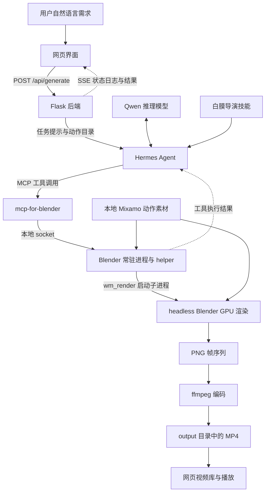
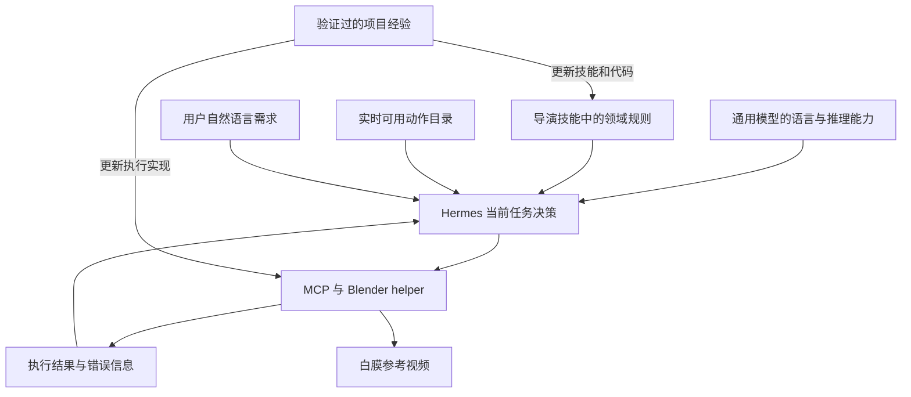

# 白膜参考视频生成系统项目汇报

汇报日期：2026 年 10 月 12 日

本项目将自然语言需求转化为可观看的三维白膜参考视频。用户描述人物动作、视频时长和镜头要求，系统自动选择本地动作素材，由 Hermes Agent 调用 Blender 完成场景组织、相机设置和渲染，再将 MP4 视频返回网页。

项目已打通自然语言输入到视频输出的主流程。Hermes 的领域能力由通用大模型、白膜导演技能、动作素材目录、Blender 执行工具和工具反馈共同构成。当前可以生成单动作和多动作参考视频；任意动作之间的自然衔接仍是后续重点建设内容。

## 1 项目目标与应用场景

白膜视频以统一的浅灰材质呈现人物，重点展示动作、姿态和镜头构图，减少服装、纹理与复杂场景对动作判断的干扰。它适合用于动作方案预览、镜头沟通，以及后续正式视频制作时的参考。

用户可以直接输入：“一个人连续出拳和踢腿，15 秒，镜头缓慢环绕，始终拍到人物全身。”动作文件名、素材路径和相机数值由系统在内部选择，用户无需了解 Blender 操作。

当前视频由已有的 Mixamo 骨骼动画驱动，角色为素材自带的 Beta 模型。自然语言负责表达需求，模型负责理解和选材，实际运动来自本地动画资产，画面由 Blender 渲染形成。

## 2 系统总体架构

系统按照用户交互、任务组织、智能决策、工具连接和图形执行分工，各部分通过明确接口协作。

| 组成部分 | 项目中的实现 | 主要职责 |
| --- | --- | --- |
| 用户交互 | `web/index.html` | 接收自然语言，展示生成日志、视频和分页视频库 |
| 任务组织 | `web/app.py`，Flask，端口 8090 | 校验输入，扫描动作目录，组织任务提示，启动 Hermes，返回结果 |
| 智能决策 | Hermes Agent，当前配置模型为 `qwen3.8-flash` | 理解需求、加载领域技能、选择动作与镜头参数、组织工具调用 |
| 领域知识 | `white-model-director/SKILL.md` | 提供导演规则、工作流程、镜头映射、素材经验与能力边界 |
| 工具连接 | `mcp-for-blender` 与 Blender addon | 将 Agent 的工具请求转换为 Blender 中的代码执行 |
| 图形执行 | `scripts/preload_helpers.py` 与渲染脚本 | 导入动画、设置材质灯光和相机、组织动画轨道、渲染视频 |
| 结果管理 | `output/` 与 `/api/videos` | 保存 MP4 和帧序列，提供历史视频列表及播放访问 |
| 运行维护 | `start_all.sh`、`watchdog.sh`、tmux、Xvfb | 启动服务，维持虚拟显示和常驻进程，异常退出后重新拉起 |

### 控制进程与渲染进程的分工

Blender 常驻进程负责接收 MCP 请求并执行 helper。它通过 Xvfb 虚拟显示运行 GUI 模式，Blender 插件在本机 9876 端口接收命令。

最终出片由独立的 headless Blender 子进程完成。`wm_render` 将动作路径、相机参数、分辨率和帧率传给 `render_white_model.py`，子进程重新导入素材并搭建渲染场景，然后输出 PNG 帧序列，由 ffmpeg 编码为 MP4。最终视频使用的是渲染脚本重建的场景，而非直接把常驻 GUI 场景原样导出。

这种分工让 Agent 保持逐步控制能力，同时沿用已验证的 headless GPU 渲染路径。当前使用 Blender 5.2.2，默认渲染引擎为 EEVEE；视频编码使用 ffmpeg 的 libx264。材质等新参数必须贯通到渲染脚本，才能真正影响最终出片。

### MCP 的作用

MCP 是 Agent 连接外部工具的协议。在本项目中，Hermes 使用 MCP 客户端连接 `mcp-for-blender`，工具服务再通过本地 socket 与 Blender addon 通信。MCP 负责暴露和调用工具，导演规则与执行逻辑分别保存在技能文件和 helper 代码中。[MCP 架构说明](https://modelcontextprotocol.io/docs/2026-07-28/learn/architecture)

## 3 视频生成的完整流程

| 步骤 | 系统执行的工作 | 形成的结果 |
| --- | --- | --- |
| 1 提交需求 | 网页将自然语言发送到 `/api/generate` | 一条生成请求 |
| 2 组织上下文 | 后端扫描本地 FBX，加入可用动作清单、内部选材规则和用户需求 | Hermes 的任务提示 |
| 3 加载专业知识 | 任务提示指定使用白膜导演技能，Hermes 按技能机制读取相关规则 | 当前任务可使用的领域知识 |
| 4 决定动作与镜头 | Agent 将描述拆成动作意图、时长要求和构图要求，选择素材和参数 | 内部生成方案 |
| 5 逐步搭建场景 | Agent 经 MCP 调用清场、导入、材质、灯光和相机 helper | 常驻场景及本次任务参数 |
| 6 渲染与编码 | `wm_render` 启动独立 Blender 子进程，渲染 PNG，再用 ffmpeg 编码 | MP4 视频文件 |
| 7 回传结果 | 后端读取 Hermes 输出、定位视频，通过 SSE 返回日志及视频地址 | 网页可播放的生成结果 |
| 8 管理历史视频 | 视频库扫描 `output/*.mp4`，按修改时间倒序分页 | 可回看、可播放的历史产物 |

Agent 使用的标准工具流程如下。

| helper | 对应的专业操作 |
| --- | --- |
| `wm_clear` | 清空场景，重置本次任务记录 |
| `wm_import` | 导入一个或多个动作 FBX，保留一个角色并提取后续动作 |
| `wm_clay` | 应用统一白膜材质 |
| `wm_lighting` | 设置三点光与环境光 |
| `wm_camera` | 设置取景、俯仰和环绕，记录构图参数 |
| `wm_render` | 汇总动作与镜头参数，启动 headless 渲染并检查输出文件 |

技能要求每个步骤单独调用，并检查返回结果中的 `ok` 和 `message`。工具反馈进入 Agent 的后续上下文，供它判断是否继续或修正失败步骤。网页展示的是任务状态、日志和结果，当前尚未提供精确到渲染帧的进度百分比。

## 4 Hermes 如何获得专业能力

Hermes 是组织推理和工具调用的 Agent 框架，`qwen3.8-flash` 是当前提供语言理解和推理的模型。项目通过把领域规则提供给模型，并让 Agent 调用可执行工具，形成白膜视频生成能力。

可以将这套能力理解为五个相互配合的部分。

| 能力来源 | 解决的问题 | 本项目中的具体内容 |
| --- | --- | --- |
| 通用模型能力 | 如何理解自然语言并组织任务 | 理解出拳、踢腿、全身镜头、慢速环绕等描述，形成调用计划 |
| 领域技能知识 | 什么流程和判断规则适合白膜生成 | 导演角色、动作选择原则、镜头参数映射、错误处理与限制说明 |
| 当前资产事实 | 本次任务实际有哪些素材可用 | 后端实时扫描的 63 个本地 FBX 路径及类别 |
| 可执行专业工具 | 如何可靠完成 Blender 操作 | 已封装的 `bpy.wm_*` helper、动画轨道组织、渲染和编码脚本 |
| 执行反馈 | 操作是否成功，下一步如何处理 | 文件存在性检查、helper 返回值、渲染退出状态和输出文件检查 |

### 通用模型负责理解需求

模型将“有力量感地连续出拳，再接踢腿”理解为动作意图，将“始终拍到人物全身”理解为构图约束。项目再用具体规则和资产目录约束模型的选择，使其围绕实际可用的动作与工具组织方案。

通用模型的理解能力不能替代动画素材本身。当前系统通过选择和组织已有骨骼动画形成运动；缺少相应素材或执行功能的需求，仍需补充资产或扩展实现。

### 导演技能提供可复用的领域手册

`white-model-director/SKILL.md` 是当前专业知识的主要载体。项目内保存可维护的源文件，部署副本位于 Hermes 的技能目录。文件中包含触发场景、动作库说明、执行顺序、镜头参数映射、选材经验、已知错误和当前能力边界。

例如，技能规定：用户要求全身入镜时，默认采用平视全景；用户明确要求出拳和踢腿时，选材必须同时覆盖这两类意图；同类别素材也需要考虑起收姿势和循环性。它还保留了已验证的素材经验，例如 `Kicking` 首尾不同且有明显整体位移，不适合直接循环。

这些规则在任务执行时进入模型的上下文，影响它的决策。更新技能文件可以更新后续任务使用的项目规则；当前专业能力的建设主要通过技能和工具实现，没有建设本项目的模型微调训练流程。

### 技能按需加载进入任务上下文

Hermes 的技能机制采用渐进式加载：先提供技能名称和简介，Agent 再通过 `skill_view` 读取相关技能全文；若技能带有额外参考文件，可在需要时继续读取。白膜任务的后端会明确指定使用 `white-model-director`，帮助 Agent 定位正确的领域规则。[Hermes Skills 官方说明](https://hermes-agent.nousresearch.com/docs/user-guide/features/skills)

本项目的技能当前以主说明文件承载知识，尚未建设专门的动作语义向量库或检索增强生成流程。以后素材和参考资料增多时，可以增加结构化动作元数据与专题参考文件。

### 动作目录提供当前可用事实

后端每次组织任务时扫描 `mixamo_fbx/`，把真实存在的路径加入提示。这样，Agent 可以从当前素材集合选择动作，减少编造不存在文件的机会。

| 动作类别 | 本地文件数 | 覆盖的动作类型 |
| --- | --- | --- |
| 基础动作 | 8 | 站立、走路、跑步、跳跃等 |
| 徒手格斗 | 15 | 出拳、勾拳、踢击等 |
| 武器动作 | 15 | 挥砍、格挡、持械移动等 |
| 远程动作 | 8 | 瞄准、射击、换弹等 |
| 受击反应 | 12 | 受击、眩晕、倒地等 |
| 魔法动作 | 5 | 施法及相关动作 |
| 合计 | 63 | 当前本地动作集合 |

当前选材主要依赖文件名称、类别、模型理解和已写入技能的经验，系统还不会为所有动作自动计算完整的兼容性评分。

### helper 将专业操作固化为代码

领域技能描述“应该怎样做”，helper 则实现具体操作。清场、导入、材质、灯光、相机和渲染被封装为固定接口，模型主要选择高层参数，减少每次临时编写 Blender 底层代码造成的错误。

`wm_import` 保存所选动作路径，`wm_camera` 保存镜头参数，`wm_render` 读取这些记录并传给渲染进程。这些执行记录属于当前任务状态；它们与可跨任务复用的技能知识承担不同职责。

### 工具反馈支撑执行中的判断

工具调用结果会回到 Agent 上下文。例如，素材不存在时，导入 helper 返回失败原因；渲染子进程失败时，渲染 helper 返回错误信息。技能要求 Agent 根据反馈处理失败步骤，而非直接报告完成。

当前规则没有形成对每条生成视频的自动视觉验收。动作是否符合意图、衔接是否自然，仍需要观看结果；文件生成成功只能证明产物存在。

## 5 项目知识如何积累和更新

项目知识的更新通过验证过的经验进入技能文件、后端规则或 helper 代码来完成。维护流程是：发现问题，分析素材或执行逻辑，修正实现，验证结果，再更新领域说明并同步部署副本。

已经完成的一个例子是动作切换出现默认 T 姿势。原实现让相邻动作分别淡出和淡入，切换时模型会回到双臂平举的默认姿势。修复后，不同动作放在独立 NLA 轨道上重叠，新动作逐渐覆盖仍在播放的旧动作；相应经验也记录进交接文档和导演技能。

另一个例子是素材循环性。分析发现 `Kicking` 约 3.4 秒，骨盆首尾位移约 2 米，首尾姿势也不同。该经验已进入内部选材规则，使原地格斗优先考虑更合适的候选素材。但自动处理任意非循环动作的编排功能仍待建设。

Hermes 框架还提供持久记忆和技能管理能力。当前项目可明确复用的白膜专业知识主要保存在导演技能、任务提示规则和执行代码中；一次生成记录或一次用户反馈，需要经过整理和验证，才能成为可靠的项目规则。现阶段没有把每次反馈自动转换为模型权重更新或经过验收的新技能。

## 6 自然语言需求如何转化为内部方案

以“一个人先快速出拳，再接勾拳和踢腿，视频 15 秒，镜头缓慢环绕，全程显示人物全身”为例，系统可以按下表组织内部决策。下表是流程示意，实际选材由 Agent 根据当次任务决定。

| 用户表达 | 系统内部需要完成的判断 |
| --- | --- |
| 快速出拳和勾拳 | 选择覆盖拳法意图的素材，比较起收姿势与循环性 |
| 再接踢腿 | 加入踢击候选，考虑其与拳法组合的衔接风险 |
| 15 秒 | 设置输出时长要求；30 fps 时对应 450 帧 |
| 缓慢环绕 | 将环绕意图映射为相机动画参数 |
| 全程显示全身 | 优先采用平视全景、较远取景距离和安全边距 |

系统把内部选择落实为工具调用。用户只需表达画面意图，最终查看生成视频。当前人物居中与取景距离由几何范围和相机规则控制；大幅位移或伸展动作还需要在结果中检查，后续可增加覆盖整段动画的自动取景验证。

目前视频时长与一圈环绕时长共用 `orbit_seconds` 参数，正值在渲染流程中上限为 15 秒。后续可以拆分视频时长和镜头运动参数，支持独立控制。

## 7 当前成果与验证情况

| 功能 | 当前状态与范围 |
| --- | --- |
| 自然语言输入 | 已支持，网页示例和导演规则已更新，内部自动选择素材与镜头参数 |
| 动作素材管理 | 本地 63 个 FBX，由后端动态扫描并提供给 Agent |
| Agent 工具执行 | 已连接 Hermes、MCP 和 Blender helper |
| 场景与视频输出 | 已实现白膜材质、三点光、参数化相机及 MP4 出片 |
| 多动作播放 | 已实现同一角色上组织多个动作，使用跨轨道重叠混合 |
| 默认姿势问题 | 已修复切换时淡回 T 姿势的问题，4 项动画序列回归测试通过 |
| 网页回显 | 已实现 SSE 状态日志、视频结果及每页 6 个视频的分页库 |
| 服务维护 | 已实现一键启动和 tmux 守护，按进程或监听端口检查并重新拉起服务 |

一个已验证的多动作产物为 `fight_combo_15s_smooth_v2.mp4`。视频为 15.000 秒、450 帧、30 fps、1280 × 720，包含出拳和两类踢击。该样本的完整解码、两个切换点画面及全段人物边距检查通过。

以上验证说明主流程可以产出符合时长和基本取景要求的视频。多动作衔接的自然程度仍取决于素材组合和当前编排方式，不能将某个样本的通过视为所有组合都已验证。

## 8 当前限制与后续建设重点

### 动作编排与自然衔接

当前多动作渲染仍按片段等分时长，并通过 `repeat` 填充。跨轨道混合消除了默认姿势问题，但对起收姿势、运动速度、支撑脚和整体位移差异较大的动作，仍可能出现不协调。

下一步应先保留完整招式并识别不可循环素材，再加入切换点匹配、位置和朝向对齐，以及支撑脚修正。对差异过大的组合，需要补充专门的回防、收腿或转身衔接素材。相应技术判断应由系统内部完成，用户仍使用自然语言输入。

### 知识系统与选材质量

动作库需要增加语义标签、起势与收势、原始时长、循环性、整体位移和脚部接触等元数据。将这些信息与导演技能结合，可以让 Agent 依据可计算的资产事实选择组合，并通过视觉检查持续完善规则。

### 并发与任务管理

当前每次请求启动一个 Hermes 进程，多任务仍共享 Blender 场景和输出目录。后续需要任务队列、任务编号、状态跟踪与输出隔离，避免多用户同时生成时相互干扰或返回错误产物。

### 风格参数与镜头扩展

helper 已具备部分材质参数，但最终渲染脚本仍使用固定浅灰材质。后续需要把材质、背景色等配置贯通到 headless 渲染流程，并拆分视频时长与镜头运动控制。

## 9 汇报表述

本项目已经建立从自然语言需求到三维白膜参考视频的自动化主流程。Hermes 负责理解和组织任务，导演技能提供领域规则，本地动作资产提供可执行的运动素材，MCP 和 Blender 工具把决策转化为实际视频。项目的专业能力通过技能知识、工程实现和反馈验证共同建设。当前重点是进一步提升动作编排、自然衔接和多任务运行能力。

## 10 关键实现与资料

| 文件或组件 | 可对照的实现内容 |
| --- | --- |
| `web/app.py` | 自然语言任务提示、动态动作清单、Hermes 调用、SSE 与视频库接口 |
| `white-model-director/SKILL.md` | 导演技能 1.1.0，领域规则、镜头映射和当前限制 |
| `scripts/start_server.py` | Blender addon 与 helper 加载，socket 服务启动 |
| `scripts/preload_helpers.py` | 高层工具接口、当前任务参数记录、渲染子进程调用 |
| `scripts/render_white_model.py` | 动作导入、场景重建、渲染设置及 ffmpeg 编码 |
| `scripts/animation_sequence.py` | 跨轨道重叠混合，避免过渡回到默认姿势 |
| `tests/test_animation_sequence.py` | 连续动画、无空档切换、不同长度片段等回归检查 |
| `hermes/agent/system_prompt.py` 与 `hermes/tools/skills_tool.py` | 技能索引进入上下文、技能内容按需读取的机制 |
| `start_all.sh` 与 `watchdog.sh` | 启动脚本和服务重新拉起逻辑 |

项目架构及当前实现以以上代码、导演技能和项目交接记录为依据。框架机制可进一步参阅 [Hermes Skills 官方说明](https://hermes-agent.nousresearch.com/docs/user-guide/features/skills)、[Hermes MCP 官方说明](https://hermes-agent.nousresearch.com/docs/user-guide/features/mcp)及 [MCP 架构说明](https://modelcontextprotocol.io/docs/2026-07-28/learn/architecture)。
